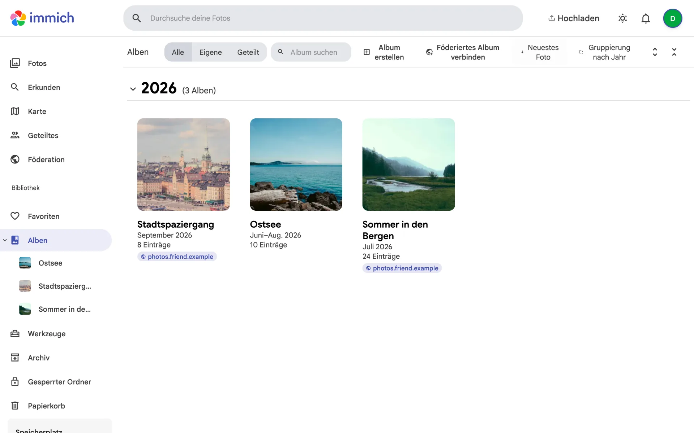
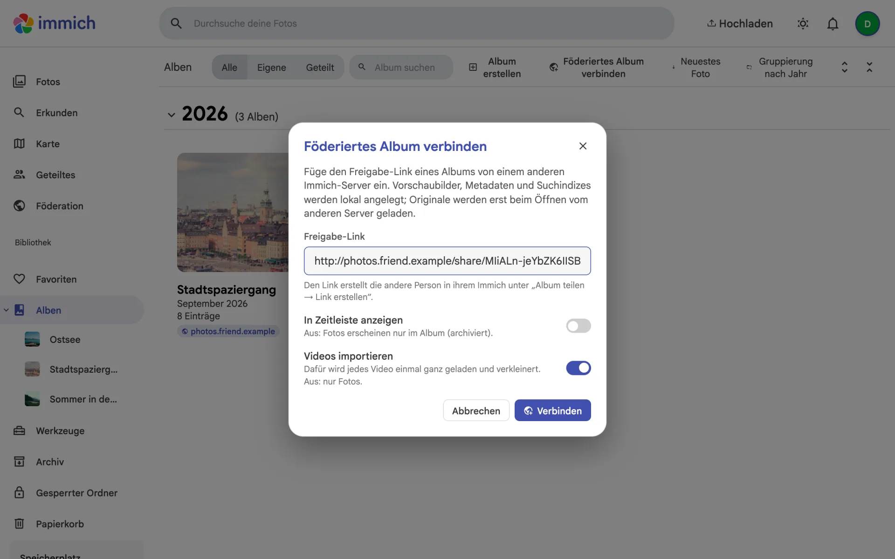
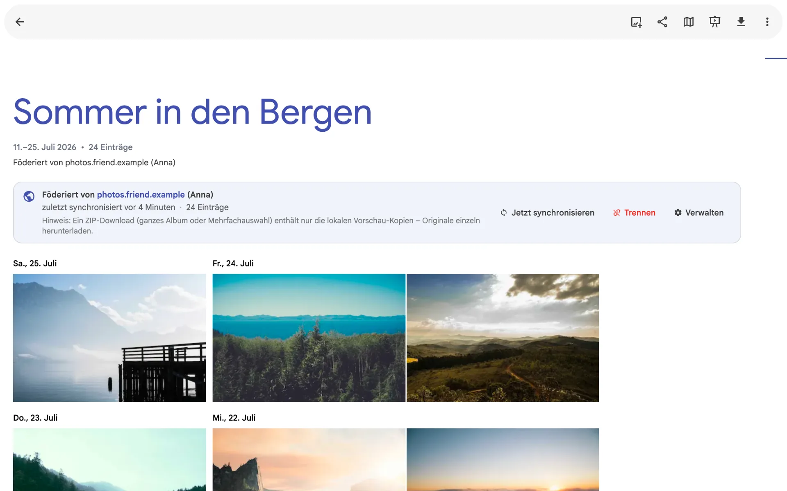
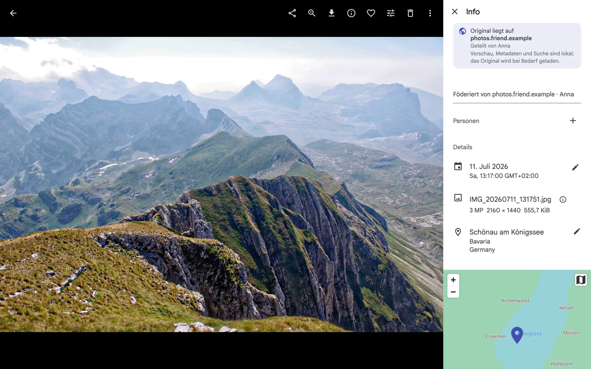
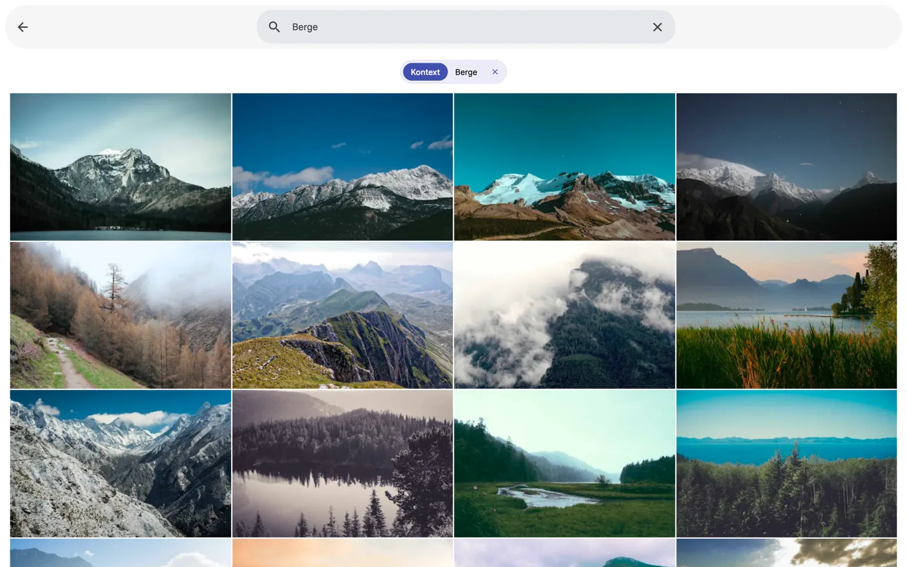
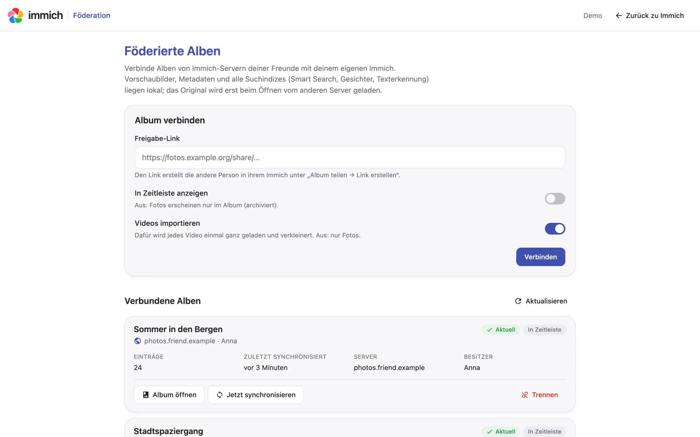
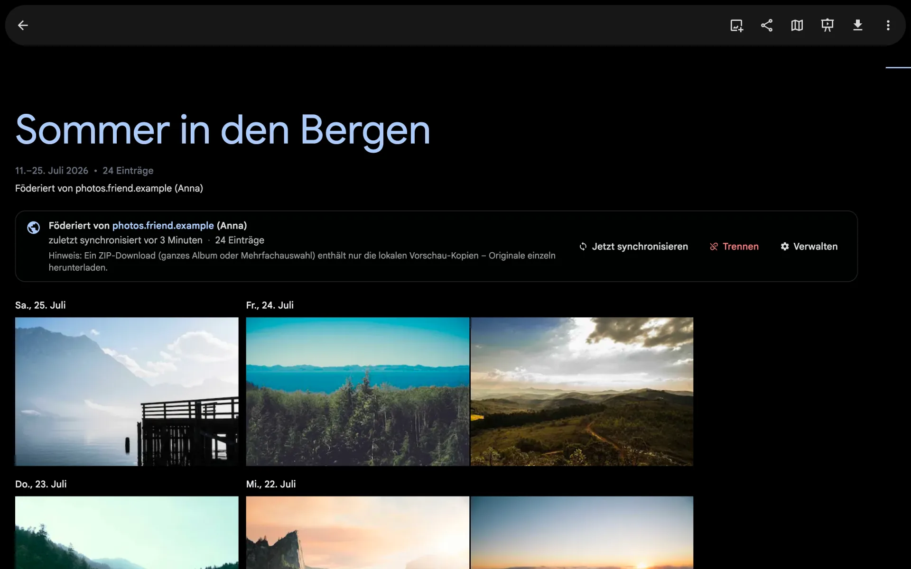
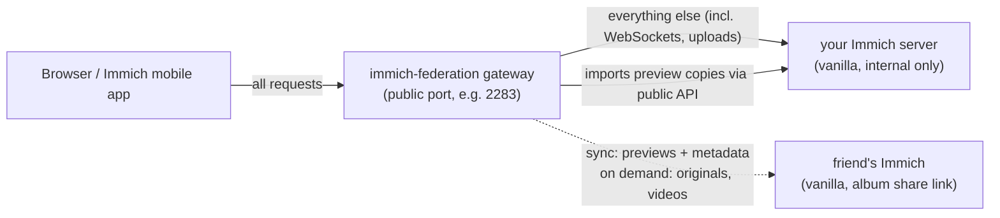

# immich-federation

**Link albums from your friends' Immich servers into your own Immich — with local thumbnails, local search and
originals streamed on demand. No fork, no patch: one extra container in front of a vanilla Immich.**

[Deutsche Version](README.de.md)



> **Not affiliated with Immich.** This is an independent community project. It is not built, endorsed or supported
> by the Immich team or FUTO. Please do not report problems with this gateway to the Immich project.

## Why

You and your friends each run your own Immich. Sharing an album with someone on another server today means a
public share link they open in a browser — the photos never show up in *their* library, timeline, map or search.

immich-federation makes a friend's album feel like a native album in your own Immich:

* **Thumbnails, previews, EXIF, map, CLIP smart search, faces and OCR live on your server.** Your Immich builds
  them itself from a preview copy the gateway imports.
* **Originals stay where they are.** Only when you zoom in, download a single photo or play a video is the
  full-quality file streamed live from your friend's server.
* **Upstream Immich stays untouched.** The gateway only uses the public Immich API and a reverse proxy. Update
  Immich as usual.
* **The federation primitive is a normal Immich album share link** that your friend creates in their vanilla Immich.
  They can revoke it at any time; "allow download" and "show metadata" are respected.

## Screenshots

| | |
|---|---|
|  |  |
| **Connect** — paste a friend's share link. | **Federated album** — banner with source, last sync, sync now, disconnect. |
|  |  |
| **Viewer** — preview, EXIF, map and people are local; the badge shows where the original lives. | **Smart search** — CLIP search runs locally and finds your friends' photos. |
|  |  |
| **`/federation/`** — manage all links, progress and errors. | Light and dark mode follow Immich. |

The UI additions are available in **English and German** and follow your Immich language setting (screenshots show
the German Immich UI). Demo photos:
[Unsplash](https://unsplash.com/license) via [Lorem Picsum](https://picsum.photos).

## How it works



1. **Connect.** You paste a friend's album share link (`https://friend.example/share/<key>` or `/s/<slug>`). The
   gateway validates it (`GET /api/shared-links/me`), then creates a dedicated, restricted Immich API key for you
   (with your session) and stores it encrypted.
2. **Sync** (immediately, every 30 minutes, or "sync now"). For each photo the gateway downloads the friend's
   preview (~1440 px JPEG); for each video the playback file, transcoded with ffmpeg to a small 480p proxy. It uploads
   that copy to your Immich through the regular API, sets capture date, GPS and a description ("Federated from …"),
   and adds it to a local album with the remote album's name. Your Immich then generates thumbnails, CLIP
   embeddings, faces and OCR — all locally. Photos removed by your friend are removed locally; photos you delete
   locally are not re-imported. Large albums are handled politely: at most 3 parallel downloads, videos one at a
   time, resumable after a restart, progress shown as *x / y*.
3. **Originals.** Requests for `/api/assets/:id/original`, `/api/assets/:id/thumbnail?size=fullsize` and
   `/api/assets/:id/video/playback` of a federated asset are first checked against your Immich (the same request as
   `HEAD` with *your* credentials, so Immich's own access rules apply, including shared links and their download
   permission). Only if Immich says yes is the file streamed from your friend (with `Range` support). If the friend
   is offline, slow (8 s) or does not allow downloads, your Immich serves the local preview copy instead.
4. **UI.** The gateway injects one small script (`/federation/inject.js`) into the Immich web app: a "connect
   federated album" button on the albums page, a banner on federated albums, a badge in the asset viewer and a
   sidebar entry. Everything is also available on the standalone page `/federation/`.

## Features

* Album share links by key (`/share/<key>`) and by slug (`/s/<slug>`), with or without metadata/download permission
* Local thumbnails, previews, EXIF (date, GPS), map, smart search, faces and OCR for federated photos
* Originals, full-size images and videos streamed from the friend on demand (with `Range` support)
* Per-link options: show in timeline or archive-only, import videos or photos only
* Automatic sync (additions and removals), resumable, bounded concurrency, progress and errors in UI and API
* Works with the Immich web app and the Immich mobile app (same server URL, same endpoints)
* Multi-user: every Immich user connects their own links with their own credentials
* English and German UI, following the language chosen in Immich (see [Language](#language))
* Zero npm dependencies, Node 24, SQLite (`node:sqlite`); ~40 MB RAM at idle

## Limitations

* **ZIP downloads** (whole album, multi-select) contain the **local preview copies**, not the originals. Download
  originals one by one (single download and zoom fetch the original from your friend).
* **Mobile app downloads** save the friend's original bytes under the local file name (`.jpg`/`.mp4`), even if
  the original is e.g. HEIC/MOV.
* **Password-protected share links are not supported** (a clear error is shown).
* **The UI injection depends on the Immich web app's DOM.** After an Immich web update the button, banner or badge
  may disappear. The core keeps working — sync, original streaming and the `/federation/` page do not depend on it.
  Run `__immichFederation.diagnose()` in the browser console to see which anchors are found.
* Remote changes to date/GPS/description after import are not re-synced (only additions and removals).
* Local edits (crop/rotate) of a federated photo make your Immich serve the edited preview copy instead of the
  friend's original. Live photos: only the still image. Stacks: imported as individual photos.
* Immich's experimental HLS real-time transcoding plays the local 480p proxy.
* Only English and German are translated so far; other Immich languages fall back to English.

## Language

The injected UI and the `/federation/` page use the language you picked in Immich (**Account settings → App
settings → Language**, stored by Immich in the browser) and fall back to your browser languages, then English. Dates
and numbers follow Immich's *Custom locale* setting. Changing the language in Immich applies without a
reload. Currently supported: **English** and **German** (incl. Swiss German variants); every other language shows
English.

* The browser sends the resolved language to the gateway (`X-Federation-Lang`, falling back to `Accept-Language`),
  so error messages, sync status and the per-link log come back in your language. API errors also carry a stable
  `code`. Server logs are always English.
* Text the gateway writes **into Immich** — the album description and the "Federated from …" footer on each
  photo's description — uses the language of the user who connected the link, fixed at connect time. Links created
  before the language support (gateway ≤ 0.1.0) keep their German texts.
* Adding a language: add a catalog to `public/i18n.js` (UI) and `src/i18n.ts` (server messages); missing keys fall
  back to English.

## Security model

The gateway sits in front of your Immich and sees all its traffic, so it is designed to never widen access:

* **Authentication is always Immich's.** The gateway has no users or passwords of its own. Every
  `/federation/api` call forwards your auth (cookie, bearer token, API key) to Immich (`GET /api/users/me`).
  Original interception mirrors the exact request as `HEAD` against Immich with the client's credentials;
  only a successful non-HTML response unlocks the remote stream. Paths are matched strictly on the raw request
  target (no normalisation tricks).
* **Share links are the trust boundary.** Your friend decides what to share, can revoke it any time, and the
  gateway only ever issues read-only `GET` requests with the share key. "Allow download" and "show metadata" are
  respected.
* **SSRF guard.** Remote URLs must be `http(s)`; private, loopback, link-local, CGNAT, multicast and documentation
  ranges (IPv4 and IPv6, incl. IPv4-mapped) are blocked. The check runs at connect time for every resolved address,
  so DNS rebinding does not bypass it; redirects are re-checked per hop. Opt out with `ALLOW_PRIVATE_REMOTES=true`
  only if your friends are on your LAN/VPN.
* **Encryption at rest.** Share keys and the per-user Immich API keys are stored AES-256-GCM encrypted, with a key
  derived (HKDF-SHA256) from `FEDERATION_SECRET`. The API never returns share keys or API keys; logs redact them.
* **Least-privilege API keys.** The gateway's Immich API key (named "Immich Federation Gateway") only has
  `asset.read/upload/update/delete`, `album.create/read/update/delete`, `albumAsset.create/delete`, `user.read`.
* **Hostile remotes.** Remote media is served only as `image/*` (no SVG), `video/*` or `audio/*`, otherwise as an
  attachment; always with `X-Content-Type-Options: nosniff` and `Content-Security-Policy: sandbox`. Downloads during
  sync are size-capped and time-limited.
* **CSRF.** State-changing endpoints require `Content-Type: application/json` and reject foreign `Origin`s.

## Installation

Requirements: Immich **v3.3.0** on your side (tested); friends' servers v3.0.3 – v3.3.0 (tested). Docker Compose.

### Docker Compose (recommended: prebuilt image)

Add a service to your Immich `docker-compose.yml` and move the port mapping from `immich-server` to the gateway:

```yaml
services:
  immich-server:
    # ... unchanged, just remove "ports:".
    # (Immich trusts X-Forwarded-* from private Docker networks by default, nothing else needed.)

  immich-federation:
    container_name: immich_federation
    image: ghcr.io/loggel/immich-federation:latest
    restart: always
    ports:
      - '2283:2283'                 # previously on immich-server
    environment:
      IMMICH_URL: http://immich-server:2283
      FEDERATION_SECRET: ${FEDERATION_SECRET}
    volumes:
      - federation-data:/data
    depends_on:
      - immich-server

volumes:
  federation-data:
```

Add to `.env`:

```sh
FEDERATION_SECRET=   # output of: openssl rand -base64 32
```

Then:

```sh
docker compose up -d immich-federation immich-server
curl -s http://localhost:2283/federation/api/health   # {"ok":true}
```

Open Immich as usual. The albums page now shows **"Connect federated album"** (German: „Föderiertes Album verbinden"); the
management page is at `/federation/` (also in the sidebar and account menu).

**About `FEDERATION_SECRET`:** without it the gateway generates `/data/secret.key` once. Key and encrypted secrets
then live in the same volume/backup, so encryption does not protect against someone holding a copy of the volume
(the gateway warns on every start). Always set it for production, via `.env` or a Docker secret. **Do not change it
later** — stored links would become unreadable.

**Bind mount instead of a volume** (`./federation-data:/data`): the gateway runs as UID 1000 and fixes ownership on
start; on NFS/root-squash run `chown -R 1000:1000 ./federation-data` first.

**Build from source instead of the image:** `git clone https://github.com/LoggeL/immich-federation gateway` next to
your compose file and replace `image:` with `build: ./gateway`.

### Behind Traefik

The gateway takes over the router labels; `immich-server` becomes internal only.

```yaml
services:
  immich-server:
    # ... image, volumes, env_file etc. unchanged
    networks:
      - default
    labels:
      - "traefik.enable=false"       # remove all previous traefik.* labels here

  immich-federation:
    container_name: immich_federation
    image: ghcr.io/loggel/immich-federation:latest
    restart: always
    environment:
      IMMICH_URL: http://immich_server:2283     # container name: unambiguous with several networks
      FEDERATION_SECRET: ${FEDERATION_SECRET}
    volumes:
      - ./federation-data:/data
    depends_on:
      - immich-server
    networks:
      - default                      # to immich-server
      - proxy                        # to Traefik
    labels:                          # the labels immich-server had before
      - "traefik.enable=true"
      - "traefik.http.routers.photos.rule=Host(`photos.example.org`)"
      - "traefik.http.routers.photos.entrypoints=websecure"
      - "traefik.http.routers.photos.tls.certresolver=letsencrypt"
      - "traefik.http.services.photos.loadbalancer.server.port=2283"
      - "traefik.docker.network=proxy"

networks:
  proxy:
    external: true
```

Steps: back up your compose file, add `FEDERATION_SECRET` to `.env`, change the compose file as above (keep your
router/service names and `Host(...)`), then `docker compose up -d immich-federation immich-server`. Traefik switches
over as soon as the gateway is healthy (a few seconds of downtime). Check
`https://photos.example.org/federation/api/health` → `{"ok":true}` and `/api/server/ping` → `{"res":"pong"}`, then log
in on web and mobile.

If your platform manages domains in its UI (e.g. Dokploy "Domains"), point the domain at service
`immich-federation`, port `2283`, instead of using labels.

**Rollback:** move labels/network back to `immich-server`, remove the gateway service, `docker compose up -d`.

Other reverse proxies (nginx, Caddy, …) work the same way: point them at the gateway instead of `immich-server`.
WebSockets must be passed through as for Immich itself.

## Configuration

| Variable | Default | Description |
|---|---|---|
| `IMMICH_URL` | `http://immich-server:2283` | Internal URL of your Immich server |
| `PORT` | `2283` | Port the gateway listens on |
| `DATA_DIR` | `/data` | SQLite database, key file, temporary files |
| `FEDERATION_SECRET` | – (auto-generated) | Secret for AES-256-GCM encryption of API keys and share keys |
| `SYNC_INTERVAL_MINUTES` | `30` | Automatic sync interval |
| `ALLOW_PRIVATE_REMOTES` | `false` | Allow friends' servers on private networks (disables the SSRF range check) |
| `VIDEO_PROXY_HEIGHT` | `480` | Height of the local video copy |
| `REMOTE_TIMEOUT_MS` | `20000` | Time until the remote's response headers during sync |
| `INTERACTIVE_TIMEOUT_MS` | `8000` | Same when opening an original; afterwards the local copy is served |
| `DOWNLOAD_CONCURRENCY` | `3` | Parallel sync downloads across all links (videos additionally one at a time) |
| `MAX_PREVIEW_MB` / `MAX_VIDEO_MB` | `50` / `4096` | Larger files are skipped during sync |
| `LOG_LEVEL` | `info` | `debug`, `info`, `warn`, `error` |

## Updating

```sh
docker compose pull immich-federation && docker compose up -d immich-federation
```

The database migrates itself on start. Immich is unreachable for a few seconds during the restart; a running sync
resumes where it stopped. **Update Immich itself as usual** (`docker compose pull && docker compose up -d`) — nothing
changes on the gateway side. After a larger Immich update:

1. Open `/federation/`: links present, "last synced" recent, no errors.
2. Open a federated album (banner?) and a photo (badge "Original liegt auf …"?); zoom in — the response for the
   original carries the header `x-immich-federation`.
3. Run `__immichFederation.diagnose()` in the browser console on the albums page, an album and the viewer.
   `localStorage.setItem('ifed-debug', '1')` logs missing anchors.
4. Automated: `test/ui/ui-smoke.cjs` (Playwright, instructions in the file header).

## Uninstall

1. In `/federation/`, disconnect every link with "delete album and local copies" (otherwise the preview copies
   remain as normal photos in Immich).
2. Remove the gateway service, give the port/labels back to `immich-server`, `docker compose up -d --remove-orphans`.
3. In Immich, *Account settings → API keys*, delete **"Immich Federation Gateway"** (per user who used federation).

## Development

```sh
node --version   # >= 24 (TypeScript runs via type stripping, no dependencies, no build step)
IMMICH_URL=http://localhost:2283 DATA_DIR=./data npm start
npm test         # unit tests + smoke test against a fake Immich
```

Layout: `src/` (proxy, interception, sync engine, remote client, SQLite store, SSRF guard, crypto),
`public/` (injected script and `/federation/` page, vanilla JS), `test/` (`node --test`), `test/ui/ui-smoke.cjs`
(optional end-to-end check of the UI injection against a real Immich with Playwright).

Issues and pull requests are welcome. When reporting a UI problem, include your Immich version and the output of
`__immichFederation.diagnose()`.

## License

[MIT](LICENSE) © 2026 LoggeL. Immich is a trademark of its respective owners; this project is not affiliated with it.
